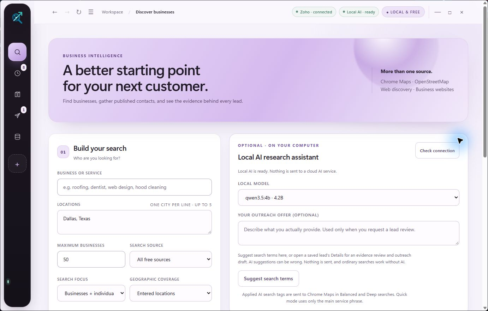

# Lead Extractor

### Local-first business discovery, evidence-backed lead intelligence, and approval-gated outreach

Lead Extractor is a free Windows desktop workspace for finding public business leads, collecting published contact details, verifying evidence, organizing research, and preparing carefully reviewed outreach. It combines multiple public sources in one linked workflow and keeps databases, browser sessions, local AI prompts, and campaign data on your computer.

No paid AI key is required. No subscription is required. Local AI is optional.



## Why this project exists

Most lead tools either lock useful data behind credits or return a flat, messy list with little explanation. Lead Extractor is built around a different idea: every useful result should carry its source, evidence strength, contact quality, and unresolved uncertainty.

The app helps you move through one continuous process:

1. Discover businesses and individual service providers.
2. Collect public websites, phones, emails, profiles, and listing evidence.
3. Verify promising records with a second research pass.
4. Merge exact duplicates while preserving source history.
5. Compile an organized research library.
6. Prepare niche-specific outreach for explicit human approval.

## Highlights

- **One linked workflow:** discovery, verification, organization, strict intelligence compilation, and outreach preparation run in sequence.
- **Multi-source waterfall:** Google Maps through a dedicated Chrome profile, OpenStreetMap, public web discovery, Wikidata, the NPI Registry for relevant US healthcare searches, business websites, and an optional local Maps Extractor API.
- **Platform-aware research:** source-specific public-profile searches for Clutch, GoodFirms, Y Combinator, Product Hunt, BetaList, Wellfound, Yelp, Yellow Pages, Manta, Chamber of Commerce, BBB, MapQuest, Alignable, Houzz, Thumbtack, Bark, Taskrabbit, Upwork, Fiverr, and other niche-relevant directories.
- **Market-signal verification:** bounded public discovery for Indeed, RemoteOK, and Wellfound, plus direct review links for the Meta Ad Library and Google Ads Transparency Center.
- **200 curated niche packs:** deterministic phrases and aliases improve query planning for home services, automotive, professional services, healthcare, hospitality, and specialty businesses.
- **Optional local AI:** automatically detects compatible local Ollama chat models and uses them for phrase suggestions, evidence summaries, and draft assistance.
- **Evidence-first records:** observed facts, search snippets, inferred classifications, and unknown fields remain distinguishable.
- **Durable diagnostics:** exact queries, provider failures, stop reasons, CAPTCHA pauses, timings, and duplicate decisions are retained for review.
- **Entity-safe normalization:** directory boilerplate, location suffixes, and pipe-delimited host labels are removed before deduplication; probable multi-listing containers are rejected.
- **NPI website waterfall:** relevant registry providers receive a second exact-name/taxonomy/city lookup, followed by published website-contact extraction.
- **Safe outreach controls:** reusable templates, per-lead AI drafts, suppression checks, daily limits, randomized respectful pacing, and explicit approval before Zoho sends.
- **Local desktop experience:** borderless, resizable Electron interface with built-in back, forward, refresh, minimize, maximize, and close controls.
- **GitHub updates and repair:** installed builds can check the official release channel, download a future update, and rebuild the local Python runtime without deleting saved research.

## Source waterfall

Lead Extractor fans out to applicable sources automatically. A source failure does not discard records collected by the other providers.

| Source | Role | Notes |
|---|---|---|
| Google Maps in Chrome | Local business discovery | Uses a dedicated, reusable Chrome profile; security checkpoints require the user |
| OpenStreetMap / Overpass | Open geographic listings | Free and attribution-aware; coverage varies by place and niche |
| Public web discovery | Websites and public profiles | Uses bounded queries and keeps source URLs |
| Business websites | Published contacts and evidence | Respects `robots.txt`, page limits, timeouts, and request pacing |
| Wikidata | Structured organization candidates | Best-effort public entity discovery |
| US NPI Registry | Healthcare providers | Used only for mapped healthcare taxonomies; a bounded second pass looks for the provider's practice website and published contacts |
| Clutch / GoodFirms | B2B service-company profiles | Public profile discovery; directory claims remain unverified until corroborated |
| YC / Product Hunt / BetaList | Startup and product signals | Activated for relevant startup, software, and product niches |
| Indeed / RemoteOK / Wellfound | Hiring and company signals | Attached to an existing company as supporting evidence, not emitted as a separate lead |
| Meta / Google ad transparency | Advertising review | Opens exact-company review paths; a tracking tag alone is not proof of an active campaign |

The project does not bypass logins, CAPTCHAs, paywalls, rate limits, or access controls. It does not claim that every platform exposes a public API.

## Local AI that remains optional

The app reads the model inventory from Ollama at `http://127.0.0.1:11434`, checks each local model’s capabilities, excludes embedding/cloud models, and offers every compatible local GGUF completion model it can verify. It does not assume one hard-coded model.

If Ollama or a compatible model is unavailable, the app explains what is missing and continues normally. Business discovery, website checks, verification, exports, history, and manual outreach templates still work. Only AI phrase expansion, evidence interpretation, and AI-written drafts are unavailable, so difficult niche searches may be less precise.

AI output is advisory. It cannot turn a search snippet into a verified fact, prove mailbox deliverability, or send a message by itself.

## Install on Windows

### Installer

Download the latest `Lead-Extractor-Setup-*.exe` from Releases and run it.

The installer asks whether to enable Google Chrome integration. If enabled, the app may open a separate Chrome profile for public Maps research and manual source review. It never imports the normal Chrome profile, saved passwords, or cookies. The choice can still be changed for an individual search.

Requirements:

- Windows 10 or Windows 11
- Python 3.10 or newer, with Python available on `PATH`
- Google Chrome only if Chrome integration is desired
- Ollama only if local AI features are desired

On first launch, the app creates its private Python environment and installs the pinned runtime packages. This can take a few minutes. User databases and browser state are stored under the app’s Windows user-data directory, not in the installation folder.

### Run from source

```powershell
git clone https://github.com/ariyankhalid97-creator/lead-intelligence-workbench.git
cd lead-intelligence-workbench
python -m venv .venv
.venv\Scripts\python.exe -m pip install -r requirements.txt
npm install
npm start
```

The browser-only fallback is:

```powershell
.venv\Scripts\python.exe dashboard.py --port 8788
```

Then open `http://127.0.0.1:8788`.

## Build the Windows installer

```powershell
npm install
npm run build:windows
```

The signed-or-unsigned NSIS installer is written to `release/`. Public distribution should use code signing; an unsigned local build may trigger Windows SmartScreen.

Future installed releases use the repository's GitHub release feed. Publish the generated installer and `latest.yml` together; the desktop app will never download an update from an arbitrary URL.

## How the research engine reasons

### 1. Research strategist

Selects niche-relevant platforms and terminology. Directory suggestions are not silently promoted to confirmed business facts.

### 2. Search planner

Builds distinct business, individual-provider, directory, location, and related-service queries within the chosen budget.

### 3. Evidence analyst

Separates first-party observations, directory claims, search snippets, and unresolved assumptions. Every retained claim keeps its source where available.

### 4. Lead qualifier

Classifies independent operators, chains/franchises, agencies, and unknown entities conservatively. Unknown does not mean independent.

### 5. Quality controller

Merges strong duplicate identities, flags possible duplicates, detects missing contacts, identifies weak sources, and preserves conflicting evidence for human review.

## Contact and email quality

Lead Extractor can identify published addresses and classify them as possible-direct, general-business, support, automated, or uncertain. Support and automated addresses are excluded from campaign preparation. DNS and MX checks describe the domain; they do not prove that a mailbox exists or accepts mail.

The app never sends probe email. A published email is not proof of consent, ownership, or deliverability.

## Zoho outreach

Zoho integration uses OAuth and the official Zoho Mail API. Client credentials and refresh tokens are stored through Windows Credential Manager or supplied through environment variables. They are not written to exports, diagnostics, or the Git repository.

Campaign behavior is intentionally conservative:

- Explicit campaign approval is required before sending.
- The default campaign limit is small and the daily cap is enforced.
- Messages are paced individually with a bounded randomized delay.
- Suppressions and prior outcomes are checked before delivery.
- Provider errors pause the campaign rather than silently continuing.
- AI drafts require usable saved evidence and remain unsent until approved.

Users are responsible for consent, lawful basis, identification, opt-out language, platform terms, and the marketing laws that apply to their recipients.

## Privacy and security

- The HTTP service binds only to `127.0.0.1`.
- Local Host and Origin checks protect browser requests.
- Electron uses `contextIsolation`, renderer sandboxing, and no Node integration.
- External links open outside the privileged application window.
- Ollama access is loopback-only and redirects are rejected.
- Chrome remote debugging is bound to loopback.
- Databases, logs, exports, browser profiles, campaign records, credentials, and local research imports are ignored by Git.
- Static files use a restrictive Content Security Policy.

This is a desktop application, not a multi-user web server. Do not proxy or expose port `8788` to another machine. See [SECURITY.md](SECURITY.md) for vulnerability reporting.

## Development and verification

Run the backend test suite:

```powershell
.venv\Scripts\python.exe -m unittest discover -s tests -v
```

Run the browser workflow tests:

```powershell
npm run test:e2e
```

Run the packaged desktop smoke test:

```powershell
npm run test:electron
```

Dependency checks used for release review:

```powershell
npm audit
.venv\Scripts\python.exe -m pip_audit -r requirements.txt
```

## Important limitations

- Coverage depends on the source, location, niche, indexing, and site availability.
- A city in a query does not prove that a company serves that city.
- Directory and search-result text can be stale or incorrect.
- Social, hiring, review, and advertising signals require human confirmation.
- Browser automation can encounter CAPTCHAs or security checkpoints; the app pauses for the user instead of bypassing them.
- Website crawling is deliberately bounded and may miss content rendered behind complex interactions.
- “Free” describes the software and its built-in source strategy; network providers may change policies or limits.

The proposed multi-country directory, geography, Google Sheets, and LinkedIn-assisted expansion is documented in [Phase 2 roadmap](docs/PHASE_2_ROADMAP.md). It deliberately distinguishes open registries from paid/licensed records and uses Google OAuth rather than embedded keys.

## Responsible use

Collect only public professional information that you have a legitimate reason to process. Respect source terms, `robots.txt`, rate limits, privacy law, anti-spam law, and opt-out requests. Do not use this project for credential harvesting, account abuse, indiscriminate messaging, sensitive-person profiling, or bypassing access controls.

## License

[MIT](LICENSE) © 2026 ariyankhalid97-creator
