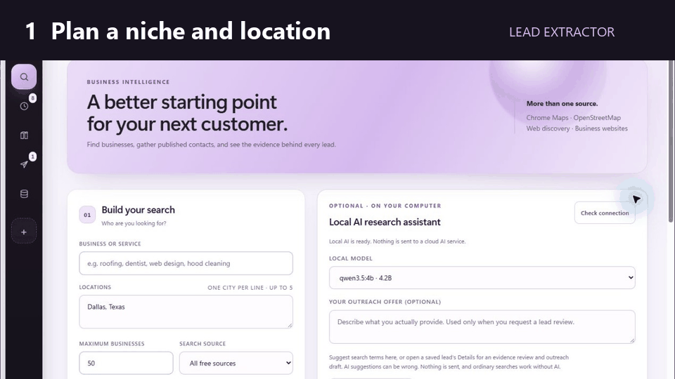

# Lead Extractor

### Local-first business discovery, evidence-backed lead intelligence, and approval-gated outreach

[](https://github.com/ariyankhalid97-creator/lead-intelligence-workbench/releases/latest)
[](LICENSE)
[](#install-on-windows)
[](#local-ai)

Lead Extractor is a free Windows desktop workspace that turns a niche and location into an organized research collection. It discovers public business records, enriches published contacts, verifies company evidence, consolidates duplicates, compiles local-AI intelligence, synchronizes approved data to Google Sheets, and prepares outreach for human review.

The application runs locally. A paid AI key and subscription are not required.

## See the workflow



Enter a niche and location, choose the applicable public sources, retain evidence for every result, and continue with new batches instead of collecting the first page again.

**[Download the latest Windows release](https://github.com/ariyankhalid97-creator/lead-intelligence-workbench/releases/latest)** · **[Read the setup guide](#install-on-windows)** · **[Request a data source](https://github.com/ariyankhalid97-creator/lead-intelligence-workbench/issues/new?template=data-source-request.yml)**

<details>
<summary>View the full desktop interface</summary>


</details>

## What the workflow does

One search can move through the complete pipeline without changing tabs:

1. **Plan** — expand the niche with curated terminology, country context, and optional local AI.
2. **Discover** — search applicable Maps, open-data, website, directory, registry, and public-profile sources.
3. **Enrich** — visit bounded public business pages and retain published websites, phones, emails, and social links.
4. **Verify** — perform a second pass for websites, email-domain signals, company LinkedIn URLs, reviews, hiring signals, advertising review paths, and technographic evidence.
5. **Organize** — normalize names, consolidate strong duplicates, retain conflicts, classify contact quality, and save a grouped research collection.
6. **Compile** — use a compatible local Ollama model to interpret retained evidence without inventing missing facts.
7. **Export or outreach** — update a titled Google Sheets worksheet or prepare a Zoho campaign that still requires explicit approval.

Searches have durable checkpoints. Pause, continue, application-restart recovery, provider failures, CAPTCHA waits, and partial results remain visible in the same saved run.

Repeated searches for the same niche and locations continue after earlier batches by default. The app loads identities from matching saved runs, scrolls Maps beyond previously observed listings, excludes cross-source repeats, and saves only newly discovered businesses in the new run. The search form includes a clear opt-out for intentional refreshes of earlier leads; source exhaustion is recorded instead of silently returning the first batch again.

### How the records stay connected

| Layer | What it preserves |
|---|---|
| Search History | Original parameters, provider queries, source events, partial results, failures, checkpoints and exact stop reasons for each run. |
| Research Library | Completed collections with canonical prospects, evidence, conflicts, duplicate lineage, verification and exports kept together. |
| Lead Intelligence | Cross-run company memory, parent-brand and operating-entity identity, locations, contacts, evidence IDs, website changes, outcomes and one next-best action. |
| AI Consistency Brain | Niche-scoped aggregate run statistics, reviewed terminology, source performance and outcome signals retrieved locally at prompt time without storing lead contacts. |
| Outreach | Approved templates and drafts, suppression decisions, campaign assignments, provider results, replies and terminal outcomes written back to company memory. |

No stage flattens the preceding one. A compiled field remains traceable to its source URL, capture time, method and evidence excerpt, while unresolved conflicts remain visible for review.

## Main capabilities

### Discovery and source planning

- Google Maps through a persistent, dedicated Chrome profile.
- OpenStreetMap and Overpass public data.
- Best-effort public web discovery with source URLs and negative-domain filtering.
- Business websites with robots-aware retrieval and bounded JavaScript rendering.
- Wikidata organizations and the US NPI Registry where relevant.
- Country-aware official-directory workspace for the United States, Singapore, Malaysia, and Australia.
- Public profile strategies for Yelp, Yellow Pages, Manta, Chamber of Commerce, BBB, MapQuest, Alignable, Houzz, Thumbtack, Bark, Taskrabbit, Clutch, GoodFirms, Y Combinator, Product Hunt, BetaList, Wellfound, and other niche-relevant sources.
- Hiring and market signals from applicable public Indeed, RemoteOK, Wellfound, Meta Ad Library, and Google Ads Transparency routes.
- Optional Google Places, Apollo, Apify, and Outscraper connections. Paid or licensed providers stay off until configured and explicitly enabled.

Sources are deliberately labeled by execution mode. Google Maps, OSM, web discovery, business websites, Wikidata, applicable NPI searches and applicable Singapore ACRA open data can participate in the automatic waterfall. The registry workspace also contains reviewed official links whose access may be manual, registration-based, key-based or paid; opening one of those links is not presented as an automated result. Optional account providers require the user's own credentials and remain disabled until selected.

### Reusable research knowledge

- 200 curated niche packs covering local services, healthcare, professional services, automotive, hospitality, property, hiring, rentals, and specialist businesses.
- Editable aliases, exclusion terms, decision-maker roles, source priorities, review signals, and technology hypotheses.
- Search-method packs for city/category discovery, nearby coverage, website gaps, reputation, identity resolution, contact enrichment, and cross-source comparison.
- A neutral offer-to-buyer planner that converts a product or service into likely buyer segments and an evidence-aware search configuration.
- Niche packs and directory definitions are versioned with the project because they improve results for every user. Personal searches, local model history, credentials, exports, and campaign records are not.

### Evidence and data quality

- Directory boilerplate, location suffixes, and host labels are removed before deduplication.
- Unbounded multi-listing containers and repeated-phone title blocks are rejected.
- News, obituary, and general-media pages are excluded unless they publish explicit `LocalBusiness` or `Organization` metadata.
- Every retained claim distinguishes first-party observations, directory claims, search snippets, model suggestions, and unknown values.
- Each compiled fact receives a stable evidence ID plus source authority, freshness and trust weights. A weak or stale observation cannot silently replace a stronger retained fact.
- Exact duplicates are merged while source history and conflicting fields remain reviewable.
- Parent brands and local operating entities are modeled separately so branches, phone numbers, contacts and suppressions do not leak across locations without supporting evidence.
- Email addresses are classified as possible-direct, general-business, support, automated, or uncertain.
- DNS and MX observations describe the mail domain only; they never claim mailbox deliverability.
- Missing information stays `not_observed`; it is never converted into a claim that something does not exist.

### Diagnostics, interruption and recovery

- Provider starts, exact queries, counts, timeouts, empty responses, merge decisions, fetch tiers and security checkpoints are appended to the saved run timeline.
- Root-cause analysis distinguishes provider failure, source exhaustion, relevance filtering, deduplication, website extraction failure and user/browser intervention instead of reporting only “zero results.”
- Pause, Continue and Stop controls preserve completed work. Interrupted application sessions are restored as resumable tasks rather than appearing complete.
- CAPTCHA, login, WAF and verification checkpoints wait for the user in the dedicated browser; the application does not attempt to defeat them.
- Repeated matching searches use continuation memory and deeper Maps scrolling, with an explicit option to include previously retained businesses when a true refresh is wanted.

### Local extraction waterfall

The website layer uses a free, bounded escalation path:

1. Validate the public URL and inspect `robots.txt`.
2. Fetch ordinary HTML with pacing, timeouts, redirect checks, and diagnostics.
3. Render a JavaScript shell only when normal HTML has no usable page content.
4. Stop and retain diagnostics when a WAF or human-verification challenge appears.
5. Convert readable content into compact, boilerplate-reduced Markdown.
6. Extract structured organization data, published contacts, social URLs, workflow signals, and literal evidence excerpts.

This follows the useful clean-content and typed-extraction patterns found in modern open-source crawlers while keeping the default runtime small and local. It does not embed Firecrawl's AGPL server or require a hosted crawling key.

### LinkedIn-assisted verification

After discovery, the verification stage can type an exact public Google query for each retained business:

```text
"Business Name" LinkedIn
```

Only `linkedin.com/company/...` candidates are accepted as company matches. A matching company URL is saved in the lead, research library, exports, and Google Sheets. Verification now refreshes the current lead worksheet automatically so newly resolved LinkedIn URLs are not left behind.

An optional, separately started employee stage can reuse the dedicated LinkedIn login to inspect verified company People pages. It retains only visibly listed professional names, headlines, profile URLs, company evidence, and observation time, deduplicates by profile URL, and writes them to a separate worksheet. Evidence-derived rules normalize visible job titles and add role group, seniority, outreach-priority, and decision-maker tags without inventing a title when LinkedIn does not show one. The run is bounded to 100 companies, 100 visible profiles per company, and 5,000 retained profiles. It never opens private contact data, sends invitations or messages, or bypasses Google or LinkedIn security checkpoints.

### Lead memory, monitoring and outcome learning

- The action queue chooses one evidence-based next step: verify, find a contact, research a decision-maker, review in the browser, prepare outreach, follow up or suppress.
- Conditional website checks reuse `ETag` and `Last-Modified` data and ignore routine timestamp, session, rotating-review and advertising-noise changes. Material contact, leadership, service, location or technology changes return the company to review.
- Recorded delivery, bounce, reply, positive reply, referral, out-of-office, meeting, customer, wrong-contact and unsubscribe outcomes update the queue and suppression state deterministically.
- Campaign variants use stable company assignment and show observed outcomes. Small samples are labeled as observations, not predictions.
- Do-not-contact controls can apply to an email, domain, parent brand or operating entity.

### Exports and connected services

- Every saved run can be downloaded as CSV or JSON; the visible filtered table can also be exported.
- Google Sheets receives organized lead tabs and a separate employee tab through user-authorized OAuth.
- Zoho Mail is the only built-in sending path and uses its official API after explicit campaign approval.
- Optional Google Places, Apollo, Apify and Outscraper credentials are stored locally and tested without returning secret values to the interface or diagnostics.

## Local AI

Lead Extractor reads the Ollama model inventory from `http://127.0.0.1:11434`, rejects cloud and embedding-only models, and offers locally installed GGUF completion models.

The current task routing favors:

- a faster compatible model for query and phrase planning;
- a stronger compatible model for qualification, strict intelligence, email judgment, and outreach drafting.

If no model is available, discovery, verification, organization, exports, Google Sheets, and manual templates continue to work. AI output is advisory and cannot browse independently, promote a snippet into a verified fact, or send outreach without approval.

Local AI is used only where it adds judgment: niche phrase suggestions, fit review, contact-role classification, evidence-bounded intelligence and unsent outreach drafts. Curated and user-approved terms can be remembered in the niche pack for later searches. Deterministic validation still controls query safety, entity identity, duplicate merging, email syntax, source provenance, DNC rules and send eligibility.

### Does continued research train the model?

It does not alter or fine-tune the installed Ollama model weights. Instead, Lead Extractor maintains a private consistency brain in SQLite. After completed workflows, reviewed phrase decisions and recorded outcomes, it rebuilds a niche-scoped snapshot containing aggregate run counts, historical source performance, contact-coverage totals, approved and rejected terminology, and outcome counts. A small relevant portion is retrieved into later prompts.

This retrieval design is deliberate: it makes repeated work more consistent while keeping evidence boundaries clear. The snapshot excludes company names, emails, phones, URLs and page text. Memory is guidance, never proof that a source was searched or a lead fact is true; current-run evidence and deterministic validation always win. The dashboard shows the memory confidence, contributing runs and feedback count, and lets the user refresh it explicitly.

The design follows the useful local persistence patterns documented by [LangGraph's SQLite checkpointer](https://github.com/langchain-ai/langgraph/tree/main/libs/checkpoint-sqlite) and the memory extraction/retrieval separation demonstrated by [Mem0](https://github.com/mem0ai/mem0), without adding their heavier runtime dependencies to the desktop application.

### Reviewed education and model benchmarks

Every compatible local model receives the same bounded research curriculum before relevant tasks. The curriculum teaches concrete niche terminology, adjacent-service boundaries, evidence authority, `not observed` versus `absent`, company and operating-location identity, conservative contact classification, qualification uncertainty and grounded outreach. These lessons contain synthetic examples only; scraped lead content never becomes general instruction.

A repeatable local competency exam scores installed models on search planning, evidence judgment, contact labels, identity boundaries and outreach safety. Results stay inside `data/ai_benchmarks.json` and are invalidated when the curriculum changes. The dashboard shows the score and measured task routing. A perfect baseline score means the model followed these bounded cases; it is not a claim of general intelligence or guaranteed lead accuracy.

For strict compilation, the model receives the retained evidence ledger rather than an unrestricted prompt. Its JSON must match the project schema; every claim and opportunity signal must cite an existing evidence ID and copy a literal supporting excerpt. A bad citation, unsupported enum or invented fact rejects the complete model response, after which the deterministic compilation remains available.

## Google Sheets setup

An API key cannot create or edit a private spreadsheet. Lead Extractor uses Google OAuth with the limited `drive.file` scope, which allows it to manage files the app creates or opens.

1. In Google Cloud, enable **Google Sheets API** and **Google Drive API**.
2. Configure the OAuth consent screen and add your Google account as a test user when the app remains in testing.
3. Create an OAuth client with application type **Desktop app**. Do not use a Web application client.
4. In Lead Extractor, open **Data sources → Connections & API keys**.
5. Save the Desktop client ID and secret, then select **Connect Google**.

The app displays the exact loopback callback used by the current installation—normally:

```text
http://127.0.0.1:8788
```

Authorization uses PKCE, a short-lived state value, and the same callback during the token exchange. A `redirect_uri_mismatch` error normally means a Web client or a different loopback address was used; create and save a Desktop app client instead.

Each organized collection can receive its own sanitized worksheet title. Optional live sync updates the current worksheet while results arrive, and second-round verification refreshes it after company LinkedIn URLs and other evidence are saved. Employee discovery creates or refreshes a separate `Employees` worksheet in the same app-owned spreadsheet.

## Zoho outreach

Zoho Mail integration uses OAuth and the official API. Client credentials and refresh tokens are stored in Windows Credential Manager.

- Templates can be reused across niches.
- Local AI can produce evidence-bounded drafts.
- Support and automated addresses are excluded from campaign preparation.
- Suppressions, prior outcomes, campaign limits, and randomized pacing are checked before delivery.
- Campaigns can use one approved template or stable multi-variant assignments for observed outcome comparison.
- Sequences contain one to five steps with increasing day delays and remain scoped to the operating entity and contact.
- Replies, opt-outs, hard bounces, wrong contacts, meetings and customer outcomes stop remaining sequence steps; out-of-office replies can pause until a retained return date.
- Referrals return to contact discovery as unverified records rather than being treated as immediately verified leads.
- Sending requires explicit campaign approval.
- Provider failures pause the campaign instead of silently skipping recipients.

Users remain responsible for consent, lawful basis, identification, opt-out language, platform terms, and applicable marketing law.

## Desktop interface

The Electron application is borderless and resizable. Back, forward, refresh, thin/wide navigation, minimize, maximize, and close controls live inside the application interface.

### Backup, reinstall and restore

Use **Data sources → Updates & repair → Save backup** to create a portable `.leadbackup` file. After reinstalling the Windows EXE, open the same panel, choose **Restore backup**, and select that file. The app restores organized searches, lead intelligence, AI teaching and benchmark memory, reference-library data, exports and supported local preferences. It validates every archived path and checksum and creates a safety backup of the current workspace before replacing databases.

The **Full personal backup** option is enabled by default for personal use. It also includes the dedicated Chrome profile and exports Google, Zoho and optional-provider credentials in a Windows DPAPI-protected payload. These private values remain excluded from Git and normal diagnostics. Keep the `.leadbackup` file private. Chrome and Credential Manager encryption is tied to the Windows user and machine, so a software reinstall under the same Windows account can restore it, while a different computer or Windows account can still require reconnection and browser login.

The workspace is organized into:

- **Discover** — search settings, plan, linked workflow, and live results.
- **History** — grouped runs with retained checkpoints and diagnostics.
- **Research library** — completed collections and collapsible intelligence sections.
- **Outreach** — Zoho connection, templates, drafts, campaigns, and outcomes.
- **Data sources** — built-in source cards, optional credentials, Google OAuth setup, updates, and repair.
- **Business registries** — reviewed official directories followed by offer-to-buyer planning.

Installed builds can check the configured GitHub release channel, show download progress and restart to install an update. The Repair action rebuilds the bundled local runtime while preserving saved searches, lead data, browser preferences, connections and outreach settings. Automatic update downloads are not forced; the user starts the download and installation from the maintenance card.

## Install on Windows

### Installer

Download `Lead-Extractor-Setup-*.exe` from GitHub Releases.

> Windows may show an unfamiliar-publisher warning until public builds are code-signed. Verify the SHA256 checksum published with the release before running the installer.

The installer can enable Chrome integration. The app creates a separate persistent profile and never imports the normal Chrome profile. Saved research and browser state live in the Windows user-data directory, not the installation folder.

Requirements:

- Windows 10 or Windows 11
- Python 3.10 or newer on `PATH`
- Google Chrome for Maps and browser-assisted review
- Ollama only for optional local-AI features

### Run from source

```powershell
git clone https://github.com/ariyankhalid97-creator/lead-intelligence-workbench.git
cd lead-intelligence-workbench
python -m venv .venv
.venv\Scripts\python.exe -m pip install -r requirements.txt
npm install
npm start
```

Browser-only fallback:

```powershell
.venv\Scripts\python.exe dashboard.py --port 8788
```

Then open `http://127.0.0.1:8788`.

## Build the installer

```powershell
npm install
npm run build:windows
```

Electron Builder writes the NSIS installer and update metadata to `release/`. Public releases should be code-signed. Publish the installer and `latest.yml` together so installed builds can use the configured GitHub update channel.

## Local data and public repository boundary

The following paths are ignored and must never be committed:

- `data/` — databases, tokens, task state, local intelligence memory, and browser metadata
- `leads/` — CSV and JSON exports
- `logs/` — diagnostics and execution logs
- `release/`, `dist/`, `test-results/`, and browser reports
- `.env*`, private keys, certificates, local virtual environments, and `node_modules/`

Credentials are stored through Windows Credential Manager. The browser never receives secret values back from the connection API.

Reusable source code, niche packs, search-method packs, directory metadata, schemas, and tests are intentionally versioned.

## Privacy, security, and responsible use

- The backend binds only to `127.0.0.1`.
- Host and Origin checks protect browser requests.
- Electron uses renderer sandboxing, context isolation, and no renderer Node integration.
- Ollama and Chrome debugging connections are loopback-only.
- External links open outside the privileged application window.
- The app does not bypass logins, CAPTCHAs, paywalls, robots directives, security checkpoints, rate limits, or access controls.
- Collect only public professional information you have a legitimate reason to process.
- Do not use the project for credential harvesting, account abuse, sensitive-person profiling, indiscriminate messaging, or unlawful outreach.

This is a local desktop application, not a multi-user server. Never expose port `8788` to another machine. See [SECURITY.md](SECURITY.md).

## Testing and release checks

Backend tests:

```powershell
.venv\Scripts\python.exe -m unittest discover -s tests -v
```

Browser workflow tests:

```powershell
npm run test:e2e
```

Desktop smoke test:

```powershell
npm run test:electron
```

Dependency and source checks:

```powershell
npm audit
.venv\Scripts\python.exe -m pip_audit -r requirements.txt
.venv\Scripts\python.exe -m bandit -r . -x .venv,node_modules,release
```

## Limitations

- A result limit is a ceiling, not a guaranteed count.
- Source coverage varies by niche, country, city, indexing, and provider availability.
- A location in a query does not prove that a company serves that location.
- Directory, social, hiring, review, and advertising claims can be stale and require human confirmation.
- A public company LinkedIn URL does not identify the correct decision-maker.
- Complex websites may expose no usable evidence even after rendering.
- Network providers can change policies, schemas, quotas, and access requirements.

## Contributing and support

- Read [CONTRIBUTING.md](CONTRIBUTING.md) before opening a pull request.
- Use [GitHub Discussions](https://github.com/ariyankhalid97-creator/lead-intelligence-workbench/discussions) for questions, use cases and ideas once enabled.
- Use the structured [issue forms](https://github.com/ariyankhalid97-creator/lead-intelligence-workbench/issues/new/choose) for confirmed bugs, features and source requests.
- Follow [SECURITY.md](SECURITY.md) for vulnerabilities. Never publish credentials, lead records, browser profiles or outreach data.

## License

[MIT](LICENSE) © 2026 ariyankhalid97-creator
